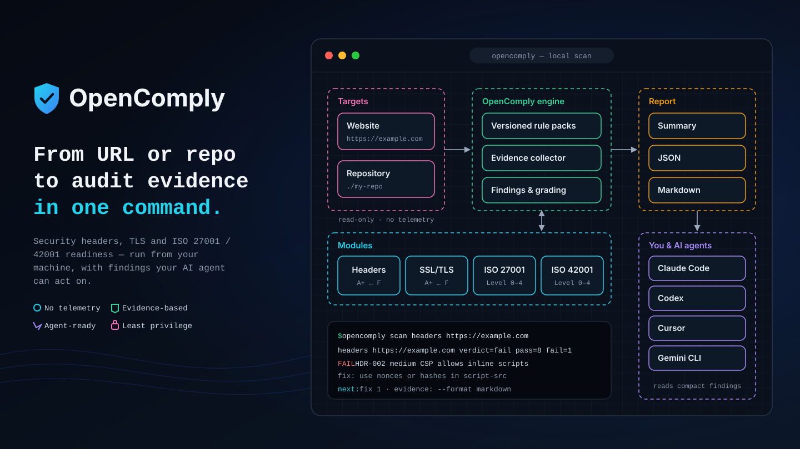

<p align="center"></p>

<p align="center"><a href="README.md">🇹🇭 ภาษาไทย</a> &nbsp;|&nbsp; <strong>🇬🇧 English</strong></p>

<h3 align="center">Website security checks<br/>that tell you what's missing, how to fix it and where, in a form developers and AI agents can build on.</h3>

<p align="center">
  
  <a href="LICENSE"></a>
  
  
</p>


## Overview

OpenComply is **a single CLI engine** that checks a website against versioned, signed rules and tells you what is missing, how to fix it and where. Pass and fail come only from the engine — no AI decides a result. You, or your AI agent, run it and act on the results.

| Module | Checks | Result |
|---|---|---|
| **HTTP Security Headers** | HSTS, CSP, X-Content-Type-Options, Referrer-Policy, Permissions-Policy, clickjacking, HTTPS enforcement, cookies, information disclosure | Grade A+ – F with a 0–100 score |

## Quick start

**Claude Code** — install the plugin:

```text
/plugin marketplace add vampirebeam/OpenComply
/plugin install opencomply@opencomply
```

Then ask in your own words, e.g. *"Check https://example.com"* or *"Is my site secure?"*, or run `/opencomply <URL>`. On first use the agent asks before installing the CLI for you. Give it the full URL — never passwords or cookies.

**CLI only:**

```bash
# Linux x86_64 / macOS Apple Silicon
curl -fsSL https://github.com/vampirebeam/OpenComply/releases/latest/download/install.sh | sh
```

```powershell
# Windows x86_64 (PowerShell)
irm https://github.com/vampirebeam/OpenComply/releases/latest/download/install.ps1 | iex
```

The installer checks the SHA-256 of the download and needs no admin rights. Other agents, reading the installer first, uninstalling and manual downloads: [Getting started](docs/GETTING_STARTED.md).

## Usage

```bash
opencomply scan headers https://example.com                    # summary
opencomply scan headers https://example.com --format markdown  # report with evidence
opencomply scan headers https://example.com --format json      # data for other programs
```

`--all` shows passed checks too · `--allow-private` scans an internal system you are authorized to assess · all options: [Getting started](docs/GETTING_STARTED.md#usage).

## Example result

An excerpt (`…` marks omitted lines), generated by the real renderer from synthetic data (example.com), not a real scan:

```console
$ opencomply scan headers https://example.com/
headers https://example.com/ verdict=fail grade=D score=63 pass=6 fail=3 unknown=0 review=0 no_evidence=0 n/a=1 advice=1 platform=cloudflare+nextjs
to C: HDR-002 +26 required → B 89
to A+: HDR-002 +26 required · HDR-005 +6 required → A+ 95
FAIL HDR-002 high Content-Security-Policy · involved
  why: script-src allows 'unsafe-inline' without a nonce or hash, so injected inline scripts can run
  fix: enforce a CSP whose script-src allows no inline or wildcard scripts
  example: change only script-src: script-src 'self' 'nonce-<random-per-request>' https://www.googletagmanager.com
  how (nextjs, preferred): middleware (proxy): create a nonce per request, set the CSP header and read it with headers() in the layout
  note (cloudflare): A static Transform Rule cannot add a per-request nonce; set the CSP in the app, use hashes, or a Worker
…
next: fix 3 · advice 1 (optional) · evidence: --format markdown
```

The full output, how to read each line, the evidence report, JSON, grades and exit codes: [Reports](docs/REPORTS.md).

## What you get

- **Evidence for every result** — the header value that decided it, the rule ID and the rule pack version, so every result can be traced.
- **Fixes for your platform** — OpenComply detects the stack (e.g. Cloudflare, nginx, WordPress, Next.js) and says where to fix each item, using your site's current values in the example. Detection only picks guidance; it never changes PASS / FAIL.
- **A path to a higher grade** — which fixes raise the grade, by how much, and what each one costs.
- **Honest results** — anything that cannot be checked is `UNKNOWN` and anything that needs your judgement is `REVIEW`; neither counts as a pass.

## Security and privacy

- **No telemetry**, no account, no API key. The CLI stores nothing and never changes your files.
- A scan sends only GET requests to the URL you give and its `http://` version. Internal addresses are refused unless you allow them; cloud metadata always is.
- When you use an AI agent, what it reads goes to that agent's model provider. The agent skill is tested and reviewed by vampirebeam, with Claude Code as the agent; AI behaviour can vary, so the CLI's own protections never depend on it.

[Security and privacy](docs/SECURITY_AND_PRIVACY.md) · [Security policy](SECURITY.md)

## Documentation

| Guide | Contents |
|---|---|
| [Getting started](docs/GETTING_STARTED.md) | Install (agent and CLI), uninstall, options |
| [Reports](docs/REPORTS.md) | Output formats, statuses, grades, exit codes, JSON schema |
| [Security and privacy](docs/SECURITY_AND_PRIVACY.md) | Data, network, AI agents, what is and is not protected, limitations |

## Contributing

[Contribution guidelines](CONTRIBUTING.md) · [Code of Conduct](CODE_OF_CONDUCT.md) · [Security policy](SECURITY.md)

## Disclaimer and license

OpenComply is an independent assessment tool, **not a certification body**. Results are not a certification of compliance and do not guarantee security. Grades are OpenComply's own and are not affiliated with any third-party rating service. Only scan systems you are authorized to assess.

Copyright 2026 vampirebeam · [Apache License 2.0](LICENSE) · [NOTICE](NOTICE). If you use or build on OpenComply, please keep the NOTICE and credit the project.
